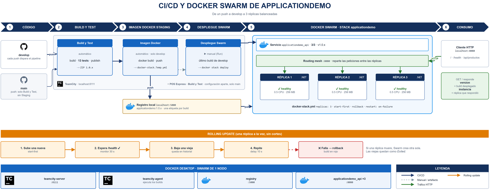

# ApplicationDemo

API mínima en .NET 10 para practicar CI/CD con TeamCity: cada push a `develop` se compila, se prueba y se publica
como imagen Docker en un registro local, lista para desplegarse en Docker Swarm con 3 réplicas.



El diagrama se edita con draw.io (`docs/arquitectura_cicd_swarm.drawio`).

El repositorio incluye además [Farmacorp POS Express](Farmacorp.PosExpress/README.md) (Práctica 06): una solución
N-Capas independiente, con su propia configuración de build en TeamCity.

## Endpoints

| Método | Ruta | Descripción |
|---|---|---|
| GET | `/` | Nombre, versión, entorno e instancia (contenedor) que respondió |
| GET | `/health` | Health check |
| GET | `/api/productos` | Lista de productos (en memoria) |
| GET | `/api/productos/{id}` | Producto por id (404 si no existe) |
| POST | `/api/productos` | Crea un producto `{ "nombre": "...", "precio": 10.5 }` |
| GET | `/api/total?precio=10&cantidad=3&descuento=10` | Calcula total con descuento |

## Local

```bash
dotnet test ApplicationDemo.slnx          # pruebas unitarias + integración
dotnet run --project ApplicationDemo      # levanta la API
docker compose up --build                 # API en http://localhost:8080
```

## Docker Swarm

`docker-stack.yml` despliega la API con 3 réplicas detrás del balanceador de Swarm, actualización gradual
(`start-first`) con rollback automático si una réplica nueva no pasa el healthcheck, y límites de CPU/memoria.

```bash
docker swarm init                                                    # una sola vez: convierte el Docker local en un Swarm de un nodo
docker build -t applicationdemo:latest -f ApplicationDemo/Dockerfile .
docker stack deploy --detach=false -c docker-stack.yml applicationdemo

docker service ls                                                    # réplicas listas: 3/3
docker service ps applicationdemo_api                                # dónde corre cada réplica y su estado
curl http://localhost:8080/                                          # "instancia" cambia entre llamadas: balanceo entre réplicas
docker service scale applicationdemo_api=5                           # escalar
```

Actualizar a otra versión (rolling update) y volver atrás:

```bash
docker build -t applicationdemo:1.0.5 --build-arg VERSION=1.0.5 -f ApplicationDemo/Dockerfile .
TAG=1.0.5 docker stack deploy --detach=false -c docker-stack.yml applicationdemo   # PowerShell: $env:TAG="1.0.5"; docker stack deploy ...
curl http://localhost:8080/                                                        # "version" pasa a 1.0.5 réplica por réplica
docker service rollback applicationdemo_api
```

`--build-arg VERSION` fija la versión de la app, que es la que devuelve `GET /` (igual a la etiqueta de la imagen); sin él la imagen reporta `1.0.0`.

Desplegar una versión publicada por TeamCity en el registro local en vez de la imagen local:

```bash
IMAGEN=localhost:5000/applicationdemo TAG=1.0.5 docker stack deploy --detach=false -c docker-stack.yml applicationdemo
# PowerShell: $env:IMAGEN="localhost:5000/applicationdemo"; $env:TAG="1.0.5"; docker stack deploy ...
curl http://localhost:5000/v2/applicationdemo/tags/list                            # versiones publicadas
```

Limpiar: `docker stack rm applicationdemo` y, si ya no se usará Swarm, `docker swarm leave --force`.

Swarm no construye imágenes: en un Swarm de varios nodos la imagen debe estar en un registro
accesible para todos los nodos.

## TeamCity

La configuración está en `.teamcity/settings.kts` (Kotlin DSL):

1. **Build y Test**: compila, ejecuta pruebas (los resultados aparecen en la pestaña *Tests*) y publica el artefacto `ApplicationDemo-<versión>.zip`. Se dispara con cada commit a `main` y a `develop`. Número de build: `1.0.<contador>`.
2. **Imagen Docker Staging**: se dispara sola cuando *Build y Test* termina bien en `develop`, y cada paso tiene la condición `teamcity.build.branch equals develop`:
   1. *Docker Build Staging*: construye `localhost:5000/applicationdemo:<versión>` (`%env.APP_IMAGE_BUILD_NUMBER%`) con `--build-arg VERSION=<versión>`, para que `GET /` devuelva la versión desplegada.
   2. *Docker Push Staging*: la sube al registro local de TeamCity y borra la imagen del agente.
   3. *Replace Staging Swarm Tokens*: `scripts/reemplazar-tokens-swarm.sh` genera `docker-stack.Temp.yml` con la imagen y la versión reemplazadas.

   Publica como artefactos `docker-stack.Temp.yml` y `scripts/desplegar-swarm.sh`.
3. **Despliegue Swarm Staging**: se ejecuta a mano. No tiene VCS root, así que no hace checkout ni hay rama que elegir: descarga el `docker-stack.Temp.yml` y el `desplegar-swarm.sh` del último build correcto de *Imagen Docker Staging* en `develop`, de modo que el archivo y la lógica de despliegue salen del mismo commit. El script comprueba que la imagen exista en el registro, numera el build con la versión desplegada y ejecuta `docker stack deploy`. Requiere que el Docker del agente sea manager de un Swarm (`docker swarm init`).
4. **POS Express - Build y Test**: compila `Farmacorp.PosExpress/Farmacorp.PosExpress.slnx`, ejecuta sus pruebas y publica la consola como `Farmacorp.PosExpress-<versión>.zip`. Se dispara solo con cambios dentro de `Farmacorp.PosExpress/` en `main`; *Build y Test* ignora esa carpeta.

### Entorno

El pipeline está probado con TeamCity 2026.2.1 sobre Docker Desktop, con tres contenedores (su compose no forma parte de este repositorio):

| Contenedor | Imagen | Acceso |
|---|---|---|
| `teamcity-server` | `jetbrains/teamcity-server:2026.2.1` | `http://localhost:8111` |
| `teamcity-agent` | agente de TeamCity con .NET SDK 10, Docker CLI y Bash | — |
| `registry` | `registry:2` | `localhost:5000`, sin cuenta ni credenciales |

El agente monta `/var/run/docker.sock` y usa la red del host: construye y despliega con el Docker de la máquina, así que
`localhost:5000` es el mismo registro para el agente y para el Swarm, y `docker stack deploy` despliega en el Swarm de ese
mismo Docker.

Antes de una demostración, comprueba con `docker ps` que los tres contenedores estén arriba: sin el agente los builds se quedan en cola.

### Rama develop

Para que TeamCity vea `develop`, la VCS root del proyecto debe incluirla: *Edit Project → VCS Roots → (la raíz del repo) → Branch specification*: `+:refs/heads/*`.

El `*` importa: TeamCity usa como nombre lógico de la rama la parte que coincide con el `*` (`develop`), que es lo que
comparan la condición `teamcity.build.branch equals develop` y los triggers. Con `+:refs/heads/develop` (sin `*`)
el nombre sería `refs/heads/develop` y los pasos de Staging se saltarían.

Al lanzar a mano *Build y Test* o *Imagen Docker Staging* (botón *Run* → pestaña *Changes* → *Build branch*), elige
`develop`: la rama por defecto es `main`, y en `main` los pasos de Staging se saltan por su condición y el build queda en
verde sin generar imagen ni `docker-stack.Temp.yml`.

*Despliegue Swarm Staging* no tiene rama: siempre toma lo último publicado en `develop`.

Pasos para conectarlo:

1. Sube el repositorio a Git (GitHub, GitLab, Azure DevOps, etc.).
2. En TeamCity: *Create project → From a repository URL* con la URL del repo.
3. TeamCity detecta `.teamcity/settings.kts` y ofrece *Import settings from VCS*: acéptalo.

Requisitos del agente: .NET SDK 10 y, para la imagen, Docker.
Si tu servidor TeamCity es anterior a 2026.2, cambia `version = "2026.2"` en `settings.kts` por la versión de tu servidor.
